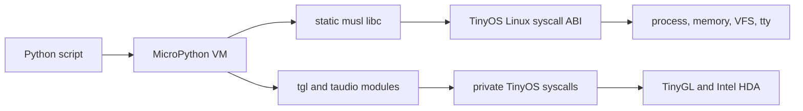

# MicroPython on TinyOS

TinyOS runs the official MicroPython Unix port as an ordinary static x86-64
userspace program. The kernel does not contain a Python interpreter and
MicroPython does not use a TinyOS-specific upstream port. Instead, TinyOS's
Linux-compatible ABI is complete enough for a minimal interpreter linked
against musl libc.

This design keeps the language runtime upstream-compatible while native
MicroPython modules expose TinyOS graphics and audio.

## Architecture



Normal Python execution, object management, bytecode dispatch, and most drawing
work happen in ring 3. The kernel is entered only for services such as files,
memory, terminal I/O, process exit, graphics presentation, and audio playback.

## Reproducible build

Run:

```sh
make setup-micropython
```

`tools/setup_micropython.sh` performs the build:

1. Fetch official MicroPython `v1.26.1`.
2. Verify commit `647c8b96cae7e202c7a020395b7cfe65e5b8ce04`.
3. Build the host-side `mpy-cross` compiler.
4. Build `ports/unix` with `VARIANT=minimal`.
5. Compile the TinyOS user C modules through `USER_C_MODULES`.
6. Link a static, non-PIE executable against the staged musl toolchain.
7. Run a host bootstrap expression and inspect the resulting ELF.

The important build settings are:

```text
CC="gcc -specs=build/musl-gcc.specs"
CFLAGS_EXTRA="-Os -fno-pie"
LDFLAGS_EXTRA="-static -no-pie"
```

The result is written to:

```text
/tmp/tinyos-micropython/micropython
```

It is a self-contained static ELF64 executable. TinyOS has no dynamic linker,
so dynamic MicroPython builds would not run.

## Image packaging

The Makefile names the host output `MICROPY_BIN` and packages it as
`/PYTHON.BIN`. The filesystem staging root also includes:

| TinyOS path | Source | Purpose |
|---|---|---|
| `/hello.py` | `programs/micropython_hello.py` | language smoke test |
| `/tgl.py` | `programs/micropython_tgl.py` | graphics smoke test |
| `/audio.py` | `programs/micropython_audio.py` | HDA tone smoke test |
| `/reversi.py` | `programs/reversi.py` | graphical, audio-enabled game |

The same interpreter and scripts are included in the embedded live RAM
filesystem, persistent FAT image, GPT disk, VHDX, and USB image. Consequently
the Python environment is consistent across QEMU, Hyper-V, and a live USB
boot.

The mbb shell resolves a bare command by trying `/NAME.BIN`, so:

```sh
python /reversi.py
```

executes `/PYTHON.BIN` with `/reversi.py` in its argument vector.

## Runtime path

When `python /reversi.py` is entered:

1. The shell calls `execve` for `/PYTHON.BIN`.
2. The TinyOS ELF loader validates the static `ET_EXEC` image.
3. It maps each `PT_LOAD` segment into a private process address space.
4. It creates a System V stack containing `argc`, `argv`, `envp`, and `auxv`.
5. Musl initializes and calls MicroPython's Unix entry point.
6. MicroPython opens, parses, compiles, and executes `/reversi.py`.
7. On exit, TinyOS reclaims the process pages and page tables.

MicroPython uses ordinary Linux-compatible calls for heap allocation, files,
directories, clocks, terminal output, and process termination. This is why the
upstream Unix port required no TinyOS-specific core changes.

## Built-in modules

The minimal image currently imports these modules:

- `builtins`
- `os`
- `sys`
- `tgl`
- `taudio`
- `__main__`, the executing script namespace

Modules such as `math`, `json`, `re`, `random`, `socket`, `ssl`, `thread`, and
`time` are not enabled in the current minimal configuration. The minimal build
also omits the `help` builtin and some optional builtins such as `min`, `max`,
and `enumerate`.

## Native module registration

`programs/micropython_port/micropython.mk` adds `modtgl.c` and `modtaudio.c` to
MicroPython's `SRC_USERMOD`. Each implementation defines a module dictionary
and registers it at build time with `MP_REGISTER_MODULE`.

These modules are compiled into `/PYTHON.BIN`; they are not `.py` files and do
not need to be copied separately into the filesystem.

## TinyGL module

Create a zero-copy surface with:

```python
import tgl

screen_width, screen_height = tgl.screen_size()
surface = tgl.Surface(420, 300)
surface.vgradient(0, 0, 420, 300, 0x081C15, 0x174D35)
surface.disc(210, 150, 52, 0xF4F1DE)
surface.text(16, 16, "Hello TinyOS", 0xFFFFFF, 2)
key = surface.present((screen_width - 420) // 2,
                      (screen_height - 300) // 2)
surface.close()
```

`tgl.Surface` provides:

- `size()` and `close()`
- `clear(color)` and `pixel(x, y, color)`
- `fill(x, y, width, height, color)`
- `blend(x, y, width, height, color, alpha)`
- `line(x0, y0, x1, y1, color)`
- `disc(center_x, center_y, radius, color)`
- `text(x, y, text, color, scale)` using the shared 8x8 TinyGL font
- `vgradient(x, y, width, height, top, bottom)`
- `present(x=0, y=0)`, which returns a pending key code

The module also exports `KEY_UP`, `KEY_DOWN`, `KEY_LEFT`, `KEY_RIGHT`, and
`KEY_ESC`.

The surface constructor asks the kernel for a buffer object. The kernel maps
its pixel pages directly into the Python process, so drawing methods write into
the shared mapping without copying a framebuffer through a syscall. Only
surface creation, presentation, and destruction cross into the kernel.

## Audio module

```python
import taudio

if taudio.ready():
    taudio.volume(60)
    taudio.tone(440, 120, 70)
```

The module provides:

- `ready()`
- `tone(hz, duration_ms, volume)`
- `stop()`
- `volume()` to read the master level
- `volume(level)` to set the master level from 0 through 100
- `info()` returning diagnostic fields as an eight-element tuple

Tone frequency is limited to 20 through 12,000 Hz, duration to 1 through 300
ms, and effect volume to 0 through 100. Playback is currently synchronous.

## Kernel boundary

The modules use private syscall numbers outside the Linux syscall range.
`modtgl.c` calls the TinyGL information, buffer-create, present, and destroy
operations. `modtaudio.c` calls HDA readiness, tone, stop, diagnostics, and
master-volume operations. `kernel/arch/arch64.c` dispatches those operations to
the graphics subsystem and Intel HDA driver.

Keeping hardware access behind syscalls preserves ring separation: Python and
its native modules run in ring 3 and never access devices directly.

## Adding another native module

1. Add a C source file under `programs/micropython_port/`.
2. Include the MicroPython API header `py/runtime.h`.
3. Convert Python objects with functions such as `mp_obj_get_int`.
4. Define callable objects with `MP_DEFINE_CONST_FUN_OBJ_*`.
5. Add functions and constants to a module globals table.
6. Register the module with `MP_REGISTER_MODULE`.
7. Add the source to `programs/micropython_port/micropython.mk`.
8. Re-run `make setup-micropython` and rebuild the desired image.

Keep module code small and validate every argument before making a syscall.
Long-running native calls block the interpreter and, for synchronous audio,
can visibly pause a game's update loop.

## Validation

Host-side checks can validate registration and Python syntax, but TinyOS-only
syscalls require a guest:

```sh
make setup-micropython
/tmp/tinyos-micropython/micropython -c "import tgl,taudio;print(tgl.Surface)"
/tmp/tinyos-micropython-src/mpy-cross/build/mpy-cross programs/reversi.py
make build/tinyos.img
```

Boot the GPT image under QEMU + OVMF with an Intel HDA device, log in, and run:

```sh
python /hello.py
python /audio.py
python /tgl.py
python /reversi.py
```

The host cannot successfully create a TinyGL surface or play a TinyOS HDA
tone because those private syscalls exist only in TinyOS.

## Current limitations

- The Unix `minimal` variant intentionally has a very small standard library.
- The shell does not group quoted arguments, so scripts are preferred over
  multi-word `python -c` expressions.
- Audio playback is synchronous and has no mixer or queued stream API.
- TinyGL is a compact software drawing API, not CPython GUI compatibility.
- Native modules must be rebuilt into the interpreter; they cannot currently
  be loaded dynamically.