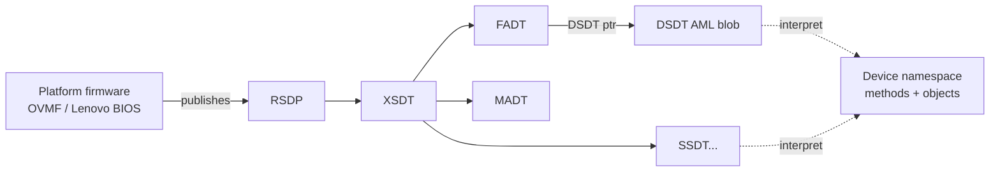
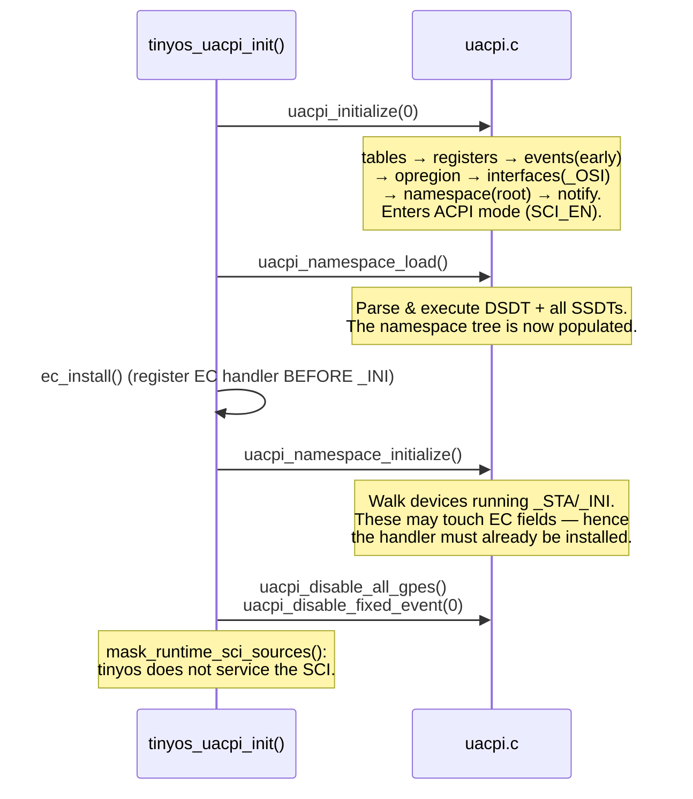
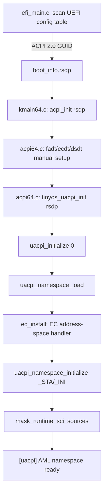

# tinyos — uACPI Design & Integration Notes

> A deep, learning-oriented reference for how the **64-bit (`ARCH=x64`) UEFI
> edition** of tinyos consumes ACPI. It covers two things at once:
>
> 1. **A uACPI deep dive** — what an AML interpreter actually *is*, how uACPI is
>    structured internally, and how it turns a firmware byte blob into a callable
>    device namespace.
> 2. **The tinyos integration** — the host "glue" layer, the build wiring, the
>    boot-time call order, the Embedded-Controller bridge, and how the S3
>    suspend/resume path drives uACPI's sleep API.
>
> This is written to be *read start-to-finish* by someone learning ACPI. If you
> only want the architecture overview, see [`ARCHITECTURE.md`](ARCHITECTURE.md);
> for the S3 power saga specifically, see the power-management section there.

---

## Table of contents

1. [ACPI in 10 minutes (background)](#1-acpi-in-10-minutes-background)
2. [Where the AML blob comes from](#2-where-the-aml-blob-comes-from)
3. [Two ACPI paths in tinyos, and why both exist](#3-two-acpi-paths-in-tinyos-and-why-both-exist)
4. [uACPI deep dive](#4-uacpi-deep-dive)
5. [The host glue layer (`uacpi_kernel_*`)](#5-the-host-glue-layer-uacpi_kernel_)
6. [Build integration](#6-build-integration)
7. [Boot-time integration and call order](#7-boot-time-integration-and-call-order)
8. [The Embedded Controller bridge](#8-the-embedded-controller-bridge)
9. [S3 sleep/wake: how tinyos drives uACPI's sleep API](#9-s3-sleepwake-how-tinyos-drives-uacpis-sleep-api)
10. [Configuration knobs](#10-configuration-knobs)
11. [Design rationale, simplifications, and their risks](#11-design-rationale-simplifications-and-their-risks)
12. [Reference: file map and call flows](#12-reference-file-map-and-call-flows)
13. [Learning exercises](#13-learning-exercises)

---

## 1. ACPI in 10 minutes (background)

**ACPI** (Advanced Configuration and Power Interface) is the firmware↔OS contract
for enumerating and power-managing a modern PC. It has two halves:

- **Static tables** — fixed-layout C-style structs the OS reads directly:
  - **RSDP** (Root System Description Pointer): the entry point. Contains a
    pointer to the RSDT (32-bit, legacy) and XSDT (64-bit).
  - **RSDT/XSDT**: an array of pointers to every other table.
  - **FADT** (signature `"FACP"`): fixed hardware register locations — the PM1
    control/event blocks, GPE blocks, the reset register, and a pointer to the
    **DSDT**.
  - **MADT** (`"APIC"`), **HPET**, **MCFG**, **FACS**, **ECDT**, … each a fixed
    struct for a specific purpose.

- **AML** (ACPI Machine Language) — a **bytecode** program supplied by firmware
  inside the **DSDT** and any number of **SSDT**s. This is the dynamic half: it
  describes devices as a *tree of objects and methods* the OS must **interpret**
  at runtime. Methods like `_PTS` (prepare-to-sleep), `_WAK` (wake), `_STA`
  (status), `_CRS` (current resources), and the `_Sx` sleep-type packages live
  here. You cannot read these by casting a struct — you need an **AML
  interpreter**.

The key insight for this document: **the static tables are trivial to parse; the
AML is not.** uACPI exists to interpret the AML.



---

## 2. Where the AML blob comes from

**tinyos never ships or generates AML.** The blob is authored/compiled by the
platform firmware and lives in ACPI-reclaim RAM. On QEMU the AML is generated by
QEMU and handed to OVMF; on the real ThinkPad T440s it is baked into the
Lenovo/Insyde UEFI ROM. The discovery chain is:

1. **The loader captures the RSDP.** `boot/efi_main.c` scans
   `SystemTable->ConfigurationTable` for the ACPI 2.0 GUID and stores the RSDP
   physical address into `boot_info_t.rsdp` — that is the `[efi] ACPI RSDP found`
   boot line.
2. **The kernel forwards it.** `acpi_init(bi->rsdp)` runs, and at its end calls
   `tinyos_uacpi_init(rsdp)`, which stashes the address in `g_uacpi_rsdp`.
3. **uACPI asks for it back** through the host callback
   `uacpi_kernel_get_rsdp()` (`kernel/drivers/uacpi64.c`).
4. **uACPI walks to the AML.** RSDP → XSDT → FADT → the FADT's `DSDT`/`X_DSDT`
   pointer → the DSDT byte stream, plus every SSDT listed in the XSDT. Because
   `uacpi_kernel_map()` is an **identity map** (physical == virtual in tinyos), it
   reads the blob straight from the pages firmware left it in.

> Full prose walkthrough of this chain is also in
> [`ARCHITECTURE.md`](ARCHITECTURE.md). The one-line summary: **firmware DSDT/SSDT
> in memory → EFI RSDP → `g_bi.rsdp` → uACPI table walk → interpreter.**

---

## 3. Two ACPI paths in tinyos, and why both exist

tinyos deliberately has **two independent ACPI consumers**. This is unusual and
worth understanding, because it is a pragmatic teaching-kernel decision.

| | Manual path — `kernel/drivers/acpi64.c` | Interpreted path — `kernel/drivers/uacpi64.c` + `third_party/uacpi/` |
|---|---|---|
| **What it reads** | Static tables + a **raw byte-scan** of the DSDT | The full AML program, properly interpreted |
| **How** | Hand-written XSDT walk; finds `_S5_`/`_S3_` `SLP_TYP` values by scanning DSDT bytes for the `"_S5_"`/`"_S3_"` name + `Package` opcode | uACPI builds a namespace and *executes* methods |
| **Depends on** | Nothing but port I/O | The 19-file uACPI library |
| **Used for** | S5 soft-off, reset, EC port discovery (ECDT), the S3 wake **trampoline**, PM1 register fallback | `_PTS`/`_WAK`/`_GTS`, `_STA`/`_INI` namespace init, the ACPICA-equivalent sleep register sequence, the EC address-space handler |
| **Can it hang?** | No — everything is bounded/polled with timeouts | In principle yes (AML can loop), but uACPI bounds its own work |

**Why keep the manual path at all?** History and safety. The manual `_S5_`
byte-scan predates the uACPI import; it is tiny, cannot hang, and is enough to
power the machine off even if the interpreter fails to initialize on unfamiliar
firmware. It also owns the parts uACPI does *not* do for us: the low-memory
**real-mode wake trampoline** at physical `0x7000`, the FACS waking-vector
programming, and device suspend/resume ordering.

**Why add uACPI?** Because correct S3 on a real laptop *requires executing
firmware AML* (`_PTS` tells the Embedded Controller to arm wake; the
ACPICA-equivalent `SLP_TYP`/`SLP_EN` sequence is what actually sleeps the machine
the same way Linux/Windows do). A byte-scan cannot execute methods.

So the split is: **acpi64.c orchestrates; uACPI executes the AML.** `acpi_init()`
calls `tinyos_uacpi_init()`, and the S3 sequence in `acpi_s3_enter()` calls into
the `tinyos_uacpi_*` wrappers at the right moments (§9).

---

## 4. uACPI deep dive

[uACPI](https://github.com/UltraOS/uACPI) is a portable, permissively-usable ACPI
implementation and AML interpreter — an alternative to ACPICA. tinyos vendors
**version 6.0.0** (`UACPI_MAJOR/MINOR/PATCH` in
`third_party/uacpi/include/uacpi/uacpi.h`) under `third_party/uacpi/`
(`include/`, `source/`, `LICENSE`, `README.md`).

### 4.1 What "interpreting AML" means

AML is a compact, stack-oriented bytecode. A fragment like:

```asl
Method (_PTS, 1) {          // "prepare to sleep", 1 argument (the sleep state)
    Store (Arg0, \_SB.PCI0.LPCB.EC0.SLPT)   // write a field in the EC opregion
}
```

compiles to opcodes (`MethodOp`, `StoreOp`, name refs, …). The interpreter must:

1. **Tokenize** the byte stream into operations.
2. **Build a namespace** — a tree of named objects (`\`, `\_SB`, `\_SB.PCI0`, …).
3. On evaluation, **execute** an object if it is a `Method`, resolving operands,
   performing arithmetic, and — crucially — routing **field reads/writes** to the
   correct **operation-region handler** (SystemMemory, SystemIO, PCI config,
   EmbeddedController, …).

uACPI's interpreter is explicitly engineered to use **very little stack** (it is
table-driven and iterative rather than deeply recursive), which matters for a
kernel with modest kernel stacks like tinyos.

### 4.2 Internal module map (the 19 compiled units)

Each file in `third_party/uacpi/source/` is one subsystem. tinyos compiles all of
them (`UACPI_NAMES` in the [Makefile](../Makefile)):

| Unit | Responsibility |
|---|---|
| `tables.c` | RSDP→RSDT/XSDT walk, FADT decode, table install/override, checksums. *This is the code that consumes `g_uacpi_rsdp`.* |
| `namespace.c` | The named-object tree (`uacpi_namespace_node`), path lookup, root. |
| `interpreter.c` | The AML execution engine — evaluates methods, arithmetic, control flow. |
| `opcodes.c` | The AML opcode/parse-op tables that drive the interpreter. |
| `types.c` | ACPI object model — integers, strings, buffers, packages, references, method objects. |
| `opregion.c` | Operation-region lifecycle: attach/detach, dispatch reads/writes to handlers. |
| `default_handlers.c` | Built-in address-space handlers (SystemMemory, SystemIO, PCI config, …). |
| `event.c` | Event subsystem: **GPEs** (General Purpose Events) and **fixed events** (power button, etc.), wake enabling. |
| `sleep.c` | Sleep-state machinery: `_PTS`/`_GTS`/`_WAK`, `_Sx` package lookup, `SLP_TYP`/`SLP_EN` programming, wake vector. **tinyos's S3 path lives on top of this.** |
| `registers.c` | Abstraction over PM1a/b control+status, GPE registers via GAS (Generic Address Structure). |
| `resources.c` | `_CRS`/`_PRS`/`_SRS` resource descriptor parsing (every resource type in ACPI 6.x). |
| `notify.c` | Dispatch of AML `Notify()` calls to host-registered handlers. |
| `osi.c` | `_OSI("...")` interface/feature reporting to AML. |
| `mutex.c` | AML `Mutex` objects and the firmware **Global Lock** (`_GL`). |
| `io.c` | uACPI's internal I/O abstraction, layered over the host `uacpi_kernel_io_*`. |
| `utilities.c` | Convenience eval helpers (`uacpi_eval_integer`, device iteration, …). |
| `stdlib.c` | Internal `mem*/str*` and formatting (uACPI ships its own libc subset). |
| `shareable.c` | Reference-counting primitive shared by object types. |
| `uacpi.c` | Top-level orchestration: `uacpi_initialize()` and friends. |

### 4.3 The initialization state machine

uACPI is brought up in **three explicit stages**, mirroring ACPICA. tinyos runs
all three back-to-back in `tinyos_uacpi_init()`:



The staging exists so the host can slot work **between** phases. tinyos uses that
gap for one critical thing: installing the Embedded-Controller address-space
handler **after** the namespace is loaded but **before** `_STA`/`_INI` run,
because those device-init methods on a ThinkPad read EC fields (§8).

- **`uacpi_initialize(flags)`** — records tables, enters ACPI mode, stands up the
  registers/event/opregion/interface/namespace/notify subsystems. tinyos passes
  `flags = 0` (default behavior; ACPI mode *is* entered here).
- **`uacpi_namespace_load()`** — the big one: parses and executes every
  DSDT/SSDT, building the device tree.
- **`uacpi_namespace_initialize()`** — runs `_STA`/`_INI` to bring devices online.

There is also a lighter **barebones / early-table** mode
(`uacpi_setup_early_table_access`) for consumers that only need static tables —
tinyos does **not** use it; it wants the full interpreter.

### 4.4 The object & namespace model

After load, the namespace is a tree rooted at `\`. Nodes
(`uacpi_namespace_node`) carry `uacpi_object`s whose type is one of integer,
string, buffer, package, reference, operation-region, field, method, device,
mutex, event, processor, power-resource, thermal-zone, … (`types.c`). You
interact with it via:

- `uacpi_namespace_root()` — the `\` node.
- `uacpi_eval(parent, path, args, &ret)` — resolve `path` (absolute or relative)
  and, if it names a method, execute it with `args`.
- Convenience wrappers in `utilities.c` (`uacpi_eval_integer`, device search,
  etc.).

tinyos uses exactly this API in `execute_optional_state_method()` to invoke
`_GTS`, and the sleep subsystem uses it internally for `_PTS`/`_WAK`.

### 4.5 Operation regions: the reason AML can touch hardware

An **operation region** is AML's window onto an address space. When AML does
`Store(x, SOMEFIELD)` and `SOMEFIELD` lives in an `OperationRegion(..., EC, ...)`,
the interpreter calls the **address-space handler** registered for
`EmbeddedController`. Built-in handlers (`default_handlers.c`) cover
SystemMemory/SystemIO/PCI config; anything else must be provided by the host.
tinyos provides the **EC** handler (§8).

### 4.6 Events and sleep

- **Events** (`event.c`): GPEs and fixed events are how firmware signals the OS
  (lid, power button, EC activity) via the **SCI** interrupt. A full OS installs
  GPE handlers and services the SCI. tinyos does **not** wire the SCI to an IRQ;
  instead it **masks** all runtime GPEs and fixed events after init
  (`mask_runtime_sci_sources()`), then arms only the specific wake source it
  needs right before sleeping.
- **Sleep** (`sleep.c`): implements the ACPI sleep transition — find the `_Sx`
  package for the target state, run `_PTS`, program the FACS waking vector, and
  perform the two-step `SLP_TYP` then `SLP_TYP|SLP_EN` register write with the
  required cache flush. This is precisely what makes S3 resume correctly, and
  tinyos calls straight into it (§9).

---

## 5. The host glue layer (`uacpi_kernel_*`)

uACPI is OS-agnostic: it declares ~40 `uacpi_kernel_*` callbacks the host **must**
implement. All of tinyos's implementations live in
`kernel/drivers/uacpi64.c`. They are intentionally minimal — this is a
single-CPU-at-ACPI-time, identity-mapped kernel — so many are one-liners.

| Group | Callbacks | tinyos implementation notes |
|---|---|---|
| **Boot info** | `get_rsdp` | Returns the address the loader found (`g_uacpi_rsdp`). |
| **Memory map** | `map`, `unmap` | **Identity**: returns `(void*)phys`; `len` ignored. Valid because the kernel identity-maps physical RAM. |
| **Logging** | `log` | Prefixes `[uacpi] ` and prints — but **filters out anything below `WARN`** (`level > UACPI_LOG_WARN` returns early) to keep boot quiet/fast (see `BOOT_DIAG`). |
| **Heap** | `alloc`, `free` | Thin wrappers over `kmalloc`/`kfree`. |
| **Time** | `get_nanoseconds_since_boot`, `stall`, `sleep` | Backed by `micros()`/`millis()`/`sleep_ms()`; `stall` is a `pause` busy-loop. |
| **PCI** | `pci_device_open/close`, `pci_read{8,16,32}`, `pci_write{8,16,32}` | Legacy `0xCF8/0xCFC` config mechanism; **segment ≠ 0 is unsupported** (returns `NOT_FOUND`). Byte/word access is synthesized from 32-bit reads. |
| **Port I/O** | `io_map/unmap`, `io_read{8,16,32}`, `io_write{8,16,32}` | `io_map` validates `base+len ≤ 0x10000`; each access is bounds-checked against the mapped range, then a raw `in/out`. |
| **Mutex** | `create/free/acquire/release_mutex` | A `uint32_t` + `__sync_bool_compare_and_swap` spin; timeout measured against `millis()`. Safe because ACPI runs single-threaded here. |
| **Event** | `create/free/wait_for/signal/reset_event` | A CAS counter. |
| **Spinlock** | `create/free/lock/unlock_spinlock` | Same lock as the mutex **plus** interrupt disable/restore. |
| **Interrupt state** | `disable_interrupts`, `restore_interrupts` | `pushfq;cli` / conditional `sti` based on the saved IF bit. |
| **Thread id** | `get_thread_id` | Constant `1` — there is only one ACPI thread. |
| **SCI / IRQ** | `install/uninstall_interrupt_handler` | **No-ops that return OK.** tinyos never routes the SCI to an IRQ; it masks GPEs instead. |
| **Deferred work** | `schedule_work`, `wait_for_work_completion` | `schedule_work` runs the handler **inline synchronously**; completion is immediate. No work queue. |
| **Firmware request** | `handle_firmware_request` | Returns `UNIMPLEMENTED` (no AML fatal/breakpoint handling). |

**Read these as a checklist**: if you ever port uACPI to another hobby kernel,
this table *is* the port. The simplifications (identity map, single thread,
inline work, masked SCI) are exactly the shortcuts a small kernel can take — and
§11 lists what each one costs you.

---

## 6. Build integration

uACPI compiles as **freestanding C** into the same PE32+ EFI application as the
rest of the x64 kernel. Relevant [Makefile](../Makefile) pieces:

```make
UACPI_CFLAGS := $(filter-out -fPIC,$(EFI_CFLAGS)) -fPIE \
    -include kernel/include/uacpi_visibility.h -Ithird_party/uacpi/include

UACPI_NAMES := tables types uacpi utilities interpreter opcodes namespace stdlib \
               shareable opregion default_handlers io notify sleep registers \
               resources event mutex osi
UACPI_OBJS  := $(patsubst %,$(BUILD)/uacpi_%.o,$(UACPI_NAMES))
```

Key points:

- **`-fPIE` instead of `-fPIC`.** The rest of the EFI objects use `-fPIC`; uACPI
  is compiled `-fPIE` (position-independent *executable*) — a small tweak that
  keeps its internal relocations clean inside the flat EFI image.
- **The visibility shim** `kernel/include/uacpi_visibility.h` is force-included
  into every uACPI unit. It does `#pragma GCC visibility push(hidden)`, so all of
  uACPI's symbols are **hidden** — they will not collide with kernel symbols and
  stay internal to the linked image.
- **Same freestanding flags as the kernel**: `-ffreestanding -mno-red-zone
  -mno-sse -mno-mmx -fno-stack-protector -O2 -Wall -Wextra`. uACPI builds warning-
  clean under these.
- The 19 objects are appended to `EFI_OBJS` and linked into `build/BOOTX64.EFI`
  alongside `acpi64.o` and `uacpi64.o` (the glue).
- **Header dependency**: the glue and kernel objects depend on `EFI_HDRS`; the
  uACPI objects additionally depend on `UACPI_HDRS` (all of
  `third_party/uacpi/include/**`), so editing a uACPI header triggers the right
  rebuilds.

Build just the ACPI-related objects while iterating:

```sh
make build/uacpi64.o build/acpi64.o ARCH=x64
```

---

## 7. Boot-time integration and call order

There is a single entry point from the kernel: `kmain64.c` calls
`acpi_init(bi->rsdp)`, and **uACPI is initialized from inside `acpi_init()`**, at
the very end, after the manual FADT/ECDT/DSDT setup:

```c
void acpi_init(uint64_t rsdp) {
    g_rsdp = rsdp;
    fadt_init();      // PM1 ports, reset reg, DSDT ptr (manual)
    s3_prepare();     // build the S3 wake trampoline (manual)
    ecdt_init();      // discover EC command/data ports from the ECDT
    ec_probe();       // one bounded EC read; sets g_ec_present (battery)
    ...               // [acpi] diagnostics gated behind BOOT_DIAG
    if (g_last_s3_phase) { ... }        // retained S3 phase marker
    (void)tinyos_uacpi_init(rsdp);      // <-- uACPI comes up here
}
```

Then `tinyos_uacpi_init()` runs the three-stage bring-up from §4.3 and prints a
single line on success:

```
[uacpi] AML namespace ready
```

(or `[uacpi] AML initialization failed status=<n>` on failure). All the verbose
per-table / per-op logging is suppressed by the `log` callback's `WARN` filter,
which is why a normal boot shows just that one line.

> **Ordering matters.** The manual `ecdt_init()`/`ec_probe()` run first so the EC
> ports are known and `g_ec_present` is set (the battery UI needs it) *before*
> uACPI's `_INI` methods possibly poke the EC through the handler installed in
> §8.

---

## 8. The Embedded Controller bridge

On a ThinkPad, AML methods (`_PTS`, `_WAK`, `_INI`, battery/lid `_STA`) read and
write **EC fields** declared as an `OperationRegion(..., EmbeddedController,
...)`. If uACPI has **no handler** for the EmbeddedController address space, it
aborts those methods ("no handler found") — the machine would sleep but never arm
its wake source. So tinyos installs a handler that relays EC field access to its
own EC driver:

```c
static uacpi_status ec_region_handler(uacpi_region_op op, uacpi_handle op_data) {
    switch (op) {
    case UACPI_REGION_OP_ATTACH: /* no per-region context */ return UACPI_STATUS_OK;
    case UACPI_REGION_OP_DETACH: return UACPI_STATUS_OK;
    case UACPI_REGION_OP_READ:  /* per byte: acpi_ec_region_read()  */ ...
    case UACPI_REGION_OP_WRITE: /* per byte: acpi_ec_region_write() */ ...
    }
}

static void ec_install(void) {
    uacpi_install_address_space_handler(uacpi_namespace_root(),
        UACPI_ADDRESS_SPACE_EMBEDDED_CONTROLLER, ec_region_handler, UACPI_NULL);
}
```

Details that matter:

- It is installed on **the namespace root**, so uACPI recursively connects *every*
  EmbeddedController opregion — even ones whose `_REG`/`_STA` themselves need the
  EC. It is installed **between** `uacpi_namespace_load()` and
  `uacpi_namespace_initialize()` so `_INI` can use it.
- Each byte is relayed to `acpi_ec_region_read/write` (declared in `boot64.h`),
  which drive the EC over the ECDT-advertised ports using the spec ch.12
  `RD_EC`/`WR_EC` protocol, **with timeouts** so a wedged EC cannot hang the box.
- These are the *un-gated* EC accessors — separate from the battery-UI EC reads —
  precisely so the interpreter can talk to the EC even when higher-level EC use is
  gated off.

---

## 9. S3 sleep/wake: how tinyos drives uACPI's sleep API

The S3 orchestration lives in `acpi64.c` (`acpi_s3_enter`, `acpi_s3_commit`), but
the three moments that must **execute firmware AML** call thin wrappers in
`uacpi64.c`:

| Wrapper (`uacpi64.c`) | uACPI call(s) | Firmware AML executed | When |
|---|---|---|---|
| `tinyos_uacpi_prepare_s3()` | `uacpi_prepare_for_sleep_state(S3)` then optional `_GTS` | `_PTS(3)` (required); `_GTS` (deprecated, best-effort) | Just before device suspend, after APs are quiesced |
| `tinyos_uacpi_enter_s3()` | `uacpi_enter_sleep_state(S3)` | ACPICA-equivalent `SLP_TYP`/`SLP_EN` write sequence | The actual sleep, from `acpi_s3_commit()` |
| `tinyos_uacpi_wake_s3()` | `uacpi_prepare_for_wake_from_sleep_state(S3)` + `uacpi_wake_from_sleep_state(S3)` | `_WAK(3)` | After the CPU resumes and devices are restored |

```mermaid
sequenceDiagram
    participant E as acpi_s3_enter()
    participant W as uacpi64 wrappers
    participant U as uACPI sleep.c
    participant HW as hardware/firmware

    E->>W: tinyos_uacpi_prepare_s3()
    W->>U: uacpi_prepare_for_sleep_state(S3)
    U->>HW: run _PTS(3)  (EC arms wake via handler)
    W-->>E: ok
    Note over E: suspend HDA/USB/AHCI, copy wake<br/>trampoline to phys 0x7000, program FACS vector
    E->>E: arch_s3_save_context()  → acpi_s3_commit()
    W->>U: tinyos_uacpi_enter_s3() → uacpi_enter_sleep_state(S3)
    U->>HW: SLP_TYP ; SLP_TYP|SLP_EN  (machine powers off)
    HW-->>E: firmware restarts at wake vector → long-mode resume
    Note over E: arch_init(), fb_s3_resume(), restart APs,<br/>resume AHCI/USB/HDA
    E->>W: tinyos_uacpi_wake_s3()
    W->>U: prepare_for_wake + wake_from_sleep_state(S3)
    U->>HW: run _WAK(3)
```

Robustness choices worth studying:

- **Fallback register write.** If `tinyos_uacpi_enter_s3()` returns non-zero
  *before actually sleeping*, `acpi_s3_commit()` falls back to the manual
  `pm1_write(g_s3a, g_s3b)` using the byte-scanned `SLP_TYP` values. Belt and
  braces: the interpreter is preferred (it matches Linux), but the machine can
  still sleep without it.
- **`_GTS` is best-effort.** `_GTS` was removed in ACPI 5.0 and is not called by
  Linux/Windows; a flaky EC after a hard power-cycle can make it fail. tinyos
  runs it via `execute_optional_state_method()` which treats `NOT_FOUND` as OK and
  never aborts the transition on `_GTS` failure.
- **Re-mask after wake.** `tinyos_uacpi_wake_s3()` re-runs
  `mask_runtime_sci_sources()` because a wake re-enables GPEs that tinyos does not
  service.

The wake **trampoline**, FACS vector programming, NX/identity-map fixes for
physical `0x7000`, and the phase markers (CMOS reg `0x01`, `g_last_s3_phase`) are
all in the manual `acpi64.c` path — uACPI has no part in them. See the
power-management notes in [`ARCHITECTURE.md`](ARCHITECTURE.md) for that saga.

---

## 10. Configuration knobs

uACPI is configured at compile time via
`third_party/uacpi/include/uacpi/platform/config.h`. tinyos uses **full-hardware
mode** — it defines *neither* of the two big strip-down switches:

| Macro | Meaning | tinyos |
|---|---|---|
| `UACPI_REDUCED_HARDWARE` | Strip the event subsystem, global lock, and other full-HW features (for reduced-HW platforms). | **Not set** — the T440s is full hardware; S3 needs PM1/GPE. |
| `UACPI_BAREBONES_MODE` | Tables-only; no interpreter. Only needs `get_rsdp`, `map/unmap`, `log`. | **Not set** — tinyos wants the interpreter. |
| `UACPI_USE_BUILTIN_STRING` | Use uACPI's internal `mem*` instead of host's. | Not set (uACPI's `stdlib.c` still provides its own). |
| `UACPI_PHYS_ADDR_IS_32BITS` | 32-bit `uacpi_phys_addr`. | Not set — 64-bit kernel. |
| `UACPI_STATIC_TABLE_ARRAY_LEN` | Static capacity before heap is needed (default 16). | Default. |

The `flags` argument to `uacpi_initialize()` (bitmask of `UACPI_FLAG_*`, e.g.
`BAD_CSUM_FATAL`, `NO_OSI`, `PROACTIVE_TBL_CSUM`) is passed as **`0`** — default
behavior, ACPI mode entered during init.

---

## 11. Design rationale, simplifications, and their risks

The glue layer trades generality for size. Each shortcut is fine *for this
kernel's constraints* but would need revisiting to grow ACPI further. Know the
tradeoffs:

| Simplification | Why it's OK here | What it would cost / when it breaks |
|---|---|---|
| `map`/`unmap` are identity, `len` ignored | Kernel identity-maps all physical RAM | Breaks the moment ACPI tables sit above the identity-mapped window, or if you enable a higher-half-only map |
| `get_thread_id` returns a constant; mutexes are plain spins | ACPI runs single-threaded, before/around scheduler quiesce | Real concurrent AML evaluation (e.g. GPE handlers on another core) would race |
| `schedule_work` runs inline | No GPE/Notify workloads are serviced at runtime | Any real deferred-work AML (e.g. `_Lxx`/`_Exx` GPE methods) would run in the wrong context / recurse |
| SCI IRQ handlers are no-ops; GPEs masked | tinyos does not do runtime ACPI events; it only needs sleep + EC | No lid/hotkey/thermal/AC events; wake is armed manually per-sleep |
| `handle_firmware_request` unimplemented | AML fatal/breakpoint are rare and non-critical here | An AML `Fatal` op would be silently ignored |
| PCI segment ≠ 0 unsupported | The T440s / QEMU q35 use segment 0 | Multi-segment (large server) topologies wouldn't enumerate |
| Log filtered below `WARN` | Fast, quiet boot (renders to framebuffer) | Set `BOOT_DIAG=1` (see `boot64.h`) to restore INFO/TRACE when debugging |

None of these are bugs — they are the **explicit scope** of a teaching kernel
that needs "clean power-off + correct S3 + battery EC," not a full ACPI OS.

---

## 12. Reference: file map and call flows

**Files**

| Path | Role |
|---|---|
| `boot/efi_main.c` | Finds the RSDP in the UEFI config table → `boot_info_t.rsdp` |
| `kernel/boot/kmain64.c` | Calls `acpi_init(bi->rsdp)` |
| `kernel/drivers/acpi64.c` | Manual tables + `_S5_`/`_S3_` byte-scan, EC ports, S3 trampoline; calls `tinyos_uacpi_init` and the S3 wrappers |
| `kernel/drivers/uacpi64.c` | **The glue**: all `uacpi_kernel_*` callbacks, EC handler, `tinyos_uacpi_{init,prepare_s3,enter_s3,wake_s3}` |
| `kernel/include/uacpi_visibility.h` | Force-included `visibility(hidden)` shim for uACPI units |
| `kernel/include/boot64.h` | Prototypes (`tinyos_uacpi_*`, `acpi_ec_region_*`), `BOOT_DIAG`, `TINYOS_VERSION` |
| `third_party/uacpi/` | The vendored library (v6.0.0): `include/`, `source/` |

**Boot-time flow**



---

## 13. Learning exercises

If you want to *understand* this by poking it:

1. **See the AML enumeration.** Set `BOOT_DIAG 1` in `kernel/include/boot64.h`,
   rebuild, and boot under OVMF headless — the `log` filter opens up and you'll
   see uACPI's table/namespace traces on the serial console.
2. **Dump a method result.** In `tinyos_uacpi_init()`, after
   `uacpi_namespace_initialize()`, call `uacpi_eval_integer()` on a known object
   (e.g. a battery `_STA`) and print it — practice with the eval API.
3. **Trace an EC field access.** Add a temporary log line inside
   `ec_region_handler`'s READ/WRITE cases and watch `_PTS`/`_INI` touch the EC
   during S3 prepare.
4. **Break the identity map assumption.** Reason about what would fail if
   `uacpi_kernel_map` were *not* identity — which of the 19 units call `map`
   first? (Hint: `tables.c`.)
5. **Find where the AML actually runs.** Start in `sleep.c`
   (`uacpi_prepare_for_sleep_state`) and follow it into `interpreter.c` to see a
   real method evaluation.

---

*This document describes the x64 UEFI edition. uACPI is vendored at
`third_party/uacpi/` under its own license; see `third_party/uacpi/LICENSE`.*
